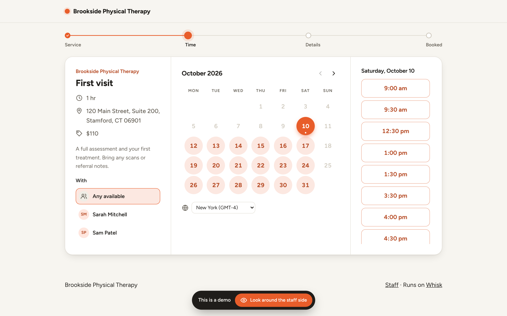

# Booking page

A self-hosted booking page for a business with appointments: a physical therapist, a salon, a consultant, a
clinic. It replaces Calendly or Acuity, runs on your own domain, and has no per-seat fees. Runs on
[Whisk](https://whisk.run) as one app.



**Live demo:** https://booking.examples.whisk.page. Book something, then press **Look around
the staff side** to see the schedule. Nothing sends email and it resets every night.

- **Booking page**: services with length, price and place; pick a person or "Any available"; a
  month calendar with only open days lit; times in the visitor's own time zone; name, email,
  phone and a note. No account needed.
- **Each booking has its own private page**: add it to Google, Outlook or Apple Calendar, move
  it or cancel it up to the cut-off you set.
- **Availability**: weekly hours per person with split shifts, time off, a buffer after each
  service, minimum notice, how far ahead people can book, and start times every 5 to 60
  minutes. Two people can never get the same slot: the time is checked again in the same
  transaction that saves it.
- **Calendar sync without connecting accounts**: paste a person's private iCal address and their
  busy times block bookings (repeating events included); each person gets a feed of their
  bookings to subscribe to in any calendar.
- **Email** through Whisk email, from your own domain once it is verified: confirmation, moved,
  canceled, and a reminder before the visit. Staff hear about new, moved and canceled bookings.
  Every message is listed with whether it went.
- **Staff side**: a week schedule with a timeline and a "now" line, a month calendar, filters
  per person; make, move and cancel bookings for people; edit services, team and settings.
  Owners, admins, developers and the `booking-admins` group change services, team and
  settings; the rest of the team sees and manages the schedule.

## Deploy

```
whisk init --name booking     # in a copy of this folder
whisk deploy
```

The first deploy adds a sample business (Brookside Physical Therapy) so every screen has something on
it. Sign in, then change it under **Services**, **Team** and **Settings**.

To answer on your own domain, add it to the app in Whisk and set `PUBLIC_URL` in `whisk.yaml`
so emails and calendar links use it.

## Prompts

**Copy this one**

```
Clone https://github.com/Whisk-Hosting/booking and deploy it to my Whisk account as an app
called "booking". Then change the sample business to mine: <name, services with length and
price, who does them and their hours>.
```

**Build your own**

```
Use https://github.com/Whisk-Hosting/booking as the reference for a booking app on Whisk. Keep
its structure, planner and tests. Ours is different like this: <for example, we hire out three
meeting rooms by the hour, the customer pays a deposit, and bookings need our approval>.
```

## How to change it

- **Look**: business name, the line under it and the color are in **Settings**. The styles are
  one file, `src/views/styles.ts`; the pages are plain functions in `src/views/`.
- **Rules**: notice, window, step, cut-off and reminder lead time are in **Settings**. The
  planner that decides which times are free is `src/slots.ts`, a pure function with table tests
  in `test/slots.test.ts`. Change a rule there and add a row to the table.
- **What customers are asked**: `readDetails` in `src/model.ts` and `detailsPage` in
  `src/views/public.ts`.
- **Emails**: the wording is in `src/emails.ts`.

## API

Everything the staff side does is also a JSON API at `/api/v1`, for other systems and AI
agents. An admin makes a key under **Settings > API keys** (it shows once; only its hash is
kept), then:

```
# Free times for a service over the next week
curl "https://<your app>/api/v1/availability?service=first-visit" -H "Authorization: Bearer bkg_..."

# Book one
curl -X POST https://<your app>/api/v1/bookings -H "Authorization: Bearer bkg_..." \
  -H "Content-Type: application/json" \
  -d '{"service": "first-visit", "start_time": "2026-11-02T14:00:00Z", "invitee": {"name": "Ana Silva", "email": "ana@example.com"}}'

# This week's bookings, 50 at a time (next_offset gives the next page)
curl "https://<your app>/api/v1/bookings?min_start_time=2026-11-02&max_start_time=2026-11-09&status=active" \
  -H "Authorization: Bearer bkg_..."

# Move one, or cancel it; the customer and staff get the same emails as from the pages
curl -X POST https://<your app>/api/v1/bookings/42/reschedule -H "Authorization: Bearer bkg_..." \
  -H "Content-Type: application/json" -d '{"start_time": "2026-11-03T15:00:00Z"}'
curl -X POST https://<your app>/api/v1/bookings/42/cancel -H "Authorization: Bearer bkg_..."
```

`GET /api/v1` lists every endpoint: services, staff with their hours and time off,
availability, bookings and customers. The key can also go in `X-Api-Key`, as the user name of
Basic auth, or in `?token=`. Field names follow Calendly's API (`start_time`, `invitee`,
`status` `active` or `canceled`). Lists take `?limit=` and `?offset=`. Errors are
`{"error": {"code", "message", "fix"}}` with 400, 401, 404, 409 (the time has gone, or the
booking can no longer change) or 422 (a field is wrong).

## How it is built

Hono on Node 22, Postgres through `postgres`, no front-end framework. Pages render on the server;
a small browser script makes the time picker quicker and solves the bot challenge on public
forms.

```
src/slots.ts         the availability planner: pure, table-tested
src/time.ts          dates and time zones, daylight saving included
src/ics.ts           calendar files out, busy times in (with repeating events)
src/model.ts         pure decisions: who may change what, when a reminder is due, form checks
src/booking.ts       book, move, cancel: lock, plan again, save, email
src/store.ts         one small query per function
src/busy.ts          reads each person's calendar address, at most every ten minutes
src/mail.ts          emails are written down first, then sent by the queue
src/functions.ts     send-email and the hourly reminders (Inngest)
src/routes/          booking pages, staff pages
src/api.ts           the JSON API at /api/v1, over the same store and booking functions
src/api-rules.ts     the API's pure parts: keys, body and query checks, JSON shapes (table-tested)
src/views/           layout, pages, styles, icons, browser script
src/demo.ts          the live demo only; delete it to remove the demo
migrations/          plain SQL, run in order by src/migrate.ts before each release
```

Whisk provides sign-in (`X-Whisk-*` headers), the database, email (`email: true`), the queue and
schedules (`functions`), the bot challenge on public forms (`routes.challenge`) and the fonts
from the edge (`static`).

## Run it locally

```
npm install && npm run build
whisk dev --as you@example.com -- npm run dev
npm test
```

`whisk dev` starts Postgres and the queue, runs the migrations and signs you in. Emails are
recorded and not sent.

## The live demo

`demo/whisk.yaml` is the same app with every page open, `DEMO=1` and a nightly reset. The
guest can make API keys in Settings to try the API; the reset removes them.
To deploy it, naming the demo app as `<org>/<app>`:

```
WHISK_DEMO_APP=examples/booking npm run deploy:demo
```

This copies the app to a temporary folder, uses `demo/whisk.yaml` there as `whisk.yaml`, and
deploys it, so this folder's manifest never changes.

## License

MIT.
